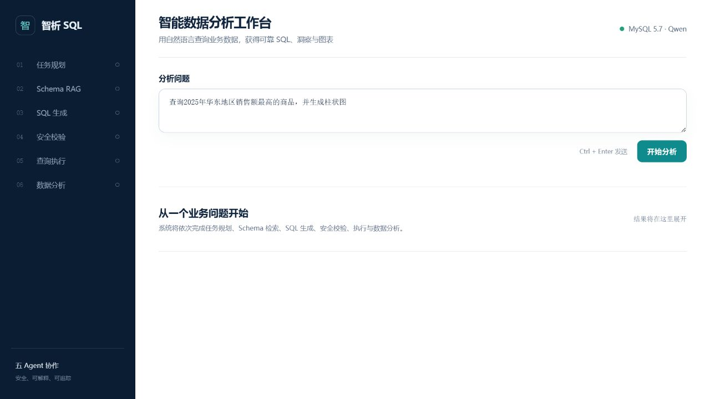
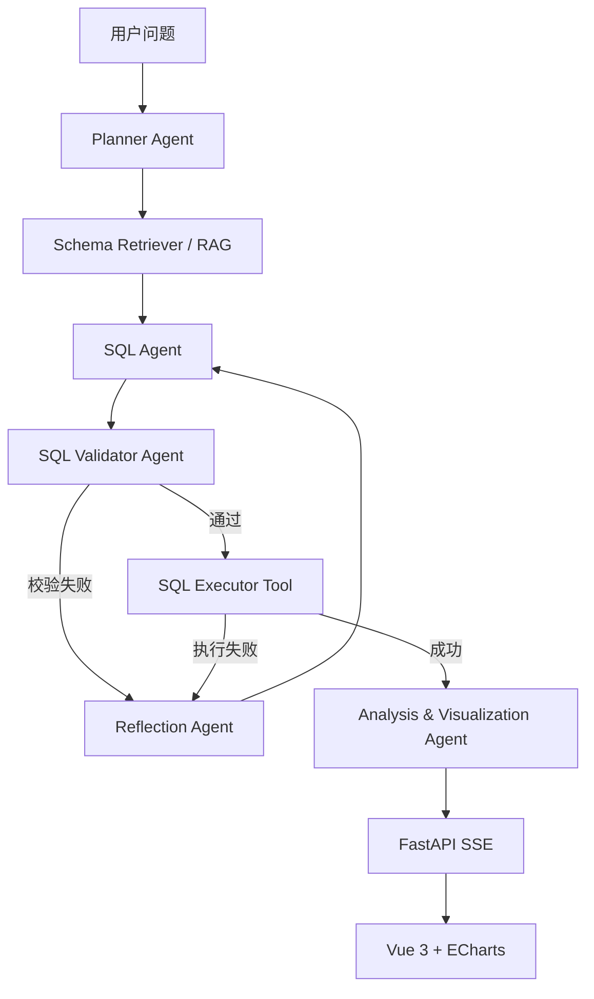

# 基于 Agent 与 RAG 的智能数据分析 NL2SQL 平台

一个面向业务分析场景的多 Agent NL2SQL 应用。用户使用自然语言提出问题，系统通过任务规划、Schema RAG、SQL 生成、安全校验、受控执行、错误反思和数据分析，返回 SQL、结构化结果、中文结论与 ECharts 图表。



## 核心能力

- 五 Agent 分工，避免一个模型同时承担规划、生成、校验和分析
- 从 MySQL `information_schema` 自动构建表、字段、注释、主外键知识
- 基于问题召回相关 Schema，并自动补齐外键关联表
- SQL 只读安全校验、单语句限制、真实表字段检查
- 查询超时、结果行数限制和结构化异常捕获
- SQL 失败后自动反思并最多重试两次
- SSE 实时返回 Planner、RAG、Validator、Executor 等阶段状态
- 请求级 Trace 记录阶段耗时、LLM 调用、Token 和 Reflection 重试次数
- 结构化会话记忆支持“那华南呢？”等上下文追问
- Vue 3 + ECharts 展示 SQL、数据表格、分析文本和图表

## 系统架构



### 五个 Agent

| Agent | 职责 | 结构化输出 |
| --- | --- | --- |
| Planner Agent | 判断数据库、图表、分析类型、时间和过滤条件 | `TaskPlan` |
| SQL Agent | 基于任务计划和召回 Schema 生成 MySQL 5.7 SQL | `SQLCandidate` |
| SQL Validator Agent | 检查只读安全、单语句、表和字段 | `ValidationResult` |
| Reflection Agent | 分析校验/执行错误并给出修正建议 | `ReflectionResult` |
| Analysis & Visualization Agent | 基于真实结果生成中文分析和图表配置 | `AnalysisResult` |

SQL Executor 是受控工具，不是 Agent。

## 技术栈

```text
Vanna 2.x · Qwen · MySQL 5.7 · FastAPI · SSE
Vue 3 · TypeScript · Vite · ECharts · Pydantic · Pytest
```

## 目录结构

```text
backend/
  app.py                              FastAPI/SSE 应用入口
frontend/
  src/App.vue                         Vue 工作台
  src/api.ts                          SSE 客户端
src/vanna/agents/nl2sql/
  planner_agent.py
  sql_agent.py
  sql_validator_agent.py
  reflection_agent.py
  analysis_visualization_agent.py
  workflow.py                         多 Agent 编排
  models.py                           共享状态模型
src/vanna/services/schema_retriever.py
src/vanna/tools/sql_executor.py
tests/                                Agent、Tool、Workflow、API 测试
```

## 环境准备

要求：

- Python 3.9+
- Node.js 20+
- MySQL 5.7+
- 阿里云百炼/通义千问 API Key

### 1. Python 环境

```powershell
conda create -n vanna python=3.11 -y
conda activate vanna
pip install -e ".[fastapi,openai,mysql,test]" python-dotenv
```

### 2. 配置环境变量

```powershell
Copy-Item .env.example .env
```

编辑 `.env`：

```dotenv
DASHSCOPE_API_KEY=your-api-key
MODEL_NAME=qwen-turbo
DASHSCOPE_BASE_URL=https://dashscope.aliyuncs.com/compatible-mode/v1
MYSQL_HOST=127.0.0.1
MYSQL_PORT=3306
MYSQL_USER=readonly_user
MYSQL_PASSWORD=your-password
MYSQL_DATABASE=ssss
```

生产环境应使用只有 `SELECT` 权限的 MySQL 用户。

### 3. 安装前端依赖

```powershell
cd frontend
npm install
```

## 启动

终端一：

```powershell
cd E:\work\agent\vanna-main
conda activate vanna
python -X utf8 -m uvicorn backend.app:app --host 127.0.0.1 --port 8000 --reload
```

终端二：

```powershell
cd E:\work\agent\vanna-main\frontend
npm run dev -- --host 127.0.0.1
```

打开：<http://127.0.0.1:5173>

## 使用示例

```text
查询2025年华东地区销售额最高的商品，并生成柱状图
```

完整响应包含：

```json
{
  "plan": {"analysis_type": "ranking", "filters": {"region": "华东"}},
  "sql": "SELECT ...",
  "execution": {"rows": [], "row_count": 0},
  "analysis": {"summary": "...", "chart": {"type": "bar", "data": []}}
}
```

## 测试

运行多 Agent 核心测试：

```powershell
python -m pytest tests/test_planner_agent.py `
  tests/test_schema_retriever.py `
  tests/test_sql_agent.py `
  tests/test_sql_validator_agent.py `
  tests/test_sql_executor_tool.py `
  tests/test_reflection_agent.py `
  tests/test_analysis_visualization_agent.py `
  tests/test_nl2sql_workflow.py `
  tests/test_backend_api.py -q
```

前端构建：

```powershell
cd frontend
npm run build
```

### NL2SQL 自动评测

项目提供面向 `ssss` 示例数据库的业务结果评测集，覆盖地区筛选、聚合、
排序、多表关联和图表选择。评测不只比较 SQL 文本，还会检查执行成功率、
表选择、中文筛选值保留、返回列、真实查询结果和图表类型。

```powershell
python -X utf8 scripts/evaluate_nl2sql.py
```

控制台输出汇总指标，详细结果写入 `evals/latest_report.json`。基准用例位于
`evals/nl2sql_cases.yaml`，新增业务问题时应同步增加对应评测用例。

当前示例数据集的最近一次完整评测结果（2026-07）：8/8 用例通过，SQL 执行
成功率、查询结果准确率、中文筛选值保留率和图表类型准确率均为 100%，平均
端到端响应时间为 3.45 秒。该结果仅代表仓库内的小型业务基准，不等同于大规模
生产数据表现；原始逐用例结果保存在 `evals/latest_report.json`。

### 多轮追问

同一浏览器页面会复用 conversation ID。系统只保存上一轮的结构化任务计划、
SQL 和有限结果预览，不会把无限增长的原始聊天记录全部发送给模型。例如：

```text
查询2025年华东地区销售额最高的商品，并生成柱状图
那华南呢？
改成折线图
```

当前会话记忆保存在后端进程内，默认最多 500 个会话、1 小时过期。生产部署
可将 `ConversationMemoryStore` 替换为 Redis，并按登录用户隔离 conversation ID。

## 安全设计

- Validator 只接受单条 `SELECT`
- 禁止注释、多语句及 DDL/DML 危险关键字
- 表名和限定字段必须存在于实时 Schema Catalog
- 对低基数业务枚举执行语义校验，并给出真实候选值
- 禁止 `CROSS JOIN`，降低意外笛卡尔积风险
- Executor 设置超时和最大返回行数
- Schema/SQL/执行结果使用 Pydantic 结构化状态传递
- 分析 Agent 只能基于实际查询结果生成结论

## 后续方向

- 使用向量模型替换当前轻量 Schema 词法召回
- 增加 SQL AST 级未限定字段校验
- 增加会话持久化、审计日志和租户权限
- 对超大结果集增加分页与异步任务

## License

MIT
